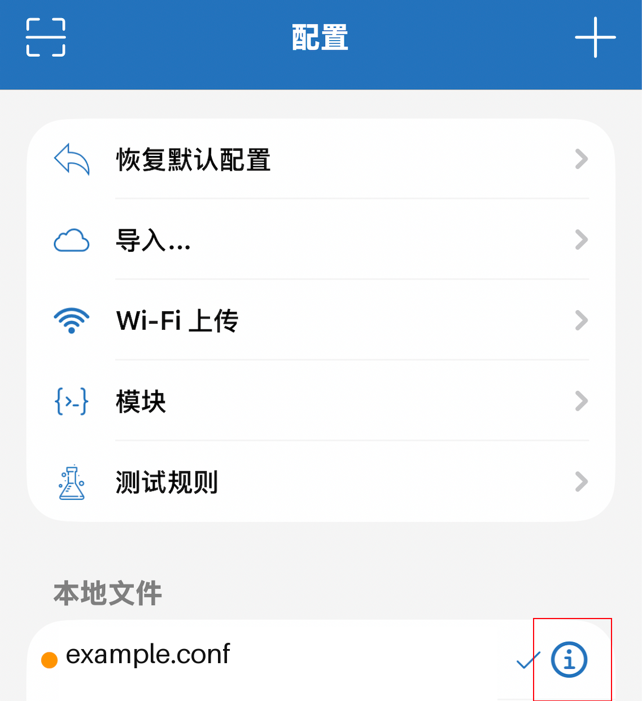
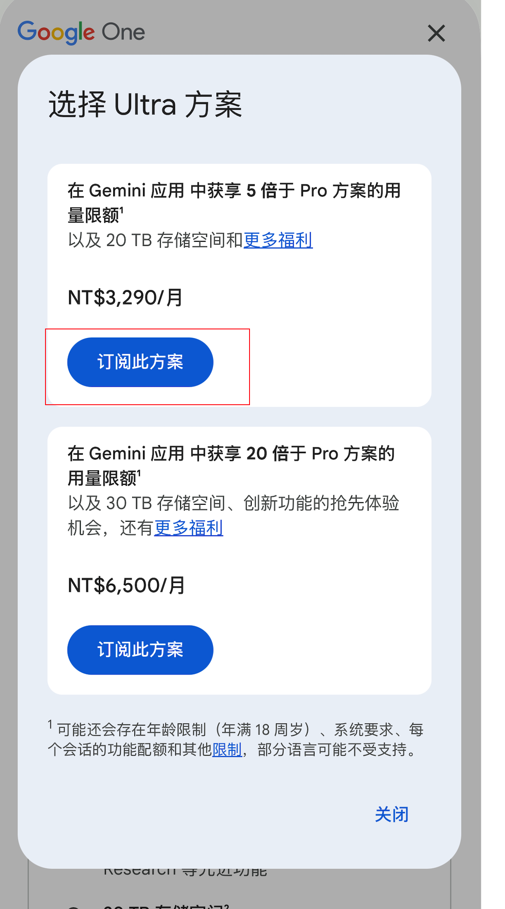

# g1-acq

[](https://t.me/muihbb)

> 💬 **AI羊毛交流群**:https://t.me/muihbb —— 交流 AI 优惠、订阅羊毛

Google One（iOS）订阅入口的商品 ID 改写与采集工具，适用于 **Shadowrocket / 小火箭**。

**v7.8.0 统一为 G1 ACQ Ultra 75p：20TB / 30TB 固定使用三个月 75p，只有 `discount75` 一个有效模式，没有 Ultra 备用目标。** 用户反馈 Ultra 试用与一折已失效，本版将原来的 75p 备用档改为默认；**75p = 75% off、实付 25%、2.5折**。原始 iOS 2TB → `g1.2tb.ai.12months_ip_90p` 的 12个月优惠测试保持原样，同时保留原始 SKU 采集、最近 10 次响应、本次新增、重复诊断与 JSON 导出，无需另装扫描器。所有当前改写入口的运行版本均为 `g1-acq-v7.8-75p`，完整步骤见 [Ultra 75p、Pro 12个月优惠测试与 SKU 扫描](docs/pro-annual-test.md)。

采集只读取手机实际收到的匹配响应，**不会主动查询全量 SKU**；旧 ID 再次出现时累加次数，清单保持原样也能代表正在收到重复数据。试用与一折的旧映射、模式与执行结果仅作为历史记录保留。

> 响应中出现商品 ID，只能证明页面携带该字符串，不等于 App Store 商品目录校验。改写命中也不等于商品可购买；商品名称、周期、初次与续费金额须在 App Store 收银台核对，权益以 Google One 账户实际状态为准。

## 主模块安装地址

**G1 ACQ Ultra 75p — 固定三个月 75p（2.5折），无 Ultra 备用**

```text
https://cdn.jsdelivr.net/gh/crhywun/g1-acq@v7.8.0/g1-acq-ultra-discount.sgmodule
```

| 项目 | 当前主入口 |
|---|---|
| 当前入口模式 `configuredMode` | `discount75`，Ultra 三个月 75p（2.5折） |
| Ultra 目标 | 三个月 75p，固定目标，无备用 |
| 响应脚本 | [g1-acq-discount.js](g1-acq-discount.js)，与 [g1-acq.js](g1-acq.js) 实现相同 |
| 响应运行版本 | `g1-acq-v7.8-75p` |
| 报告脚本 | [g1-sku-report-discount.js](g1-sku-report-discount.js)，与 [g1-sku-report.js](g1-sku-report.js) 实现相同 |
| 报告版本 | `v7.8.0` |
| 2TB 固定目标 | `g1.2tb.ai.12months_ip_90p`，无 `.acq` |
| 采集、报告与存储 | 被动采集、最近 10 响应、共享两键 schema 1 |

首次安装时在小火箭模块管理中添加上方地址并启用。升级顺序为：**关闭旧模块 → 安装新地址 → 只开启 G1 ACQ Ultra 75p 一个改写入口 → 重新连接小火箭 → 重新打开 Google App 的方案页**。曾安装旧 **G1 ACQ**、**G1 ACQ Ultra 一折**、**G1 ACQ Ultra 试用**、独立 **G1 SKU Scan**、**G1 Pro Annual Test** 或其它改写副本时，也停用这些旧副本，避免重复计数或改写。

安装入口与全部内部脚本均固定引用 `@v7.8.0`，无需单独添加脚本。**旧固定链接需换成新地址，不会自动更新。** 发布新版本需同时更新脚本内容和固定版本 pin；合并 PR 不会让旧固定 CDN 地址自动更新或失效。当前树已移除试用模块，固定 `v7.7.0` / `v7.6.0` 标签与旧试用链接仍指向原内容。更早 `v7.0.0` / `v7.1.0` / `v7.2.0` / `v7.3.0` / `v7.4.0` / `v7.5.0`、`pro-annual-test-v1` / `pro-annual-test-v2` 标签也保持不动。

升级沿用 `g1.sku.scan.v1`、`g1.pro.annual.test.v1`，`schemaVersion=1` 保持不变；累计 SKU、次数和最近 10 次响应继续保留，旧执行记录保留到新记录成功写入。报告区分当前入口 `configuredMode` 与记录中的 `scan.mode` / `test.mode`，旧记录模式缺失或为未知值时显示空值，升级不会把旧记录重标为当前模式。

旧 [g1-acq-v7.sgmodule](g1-acq-v7.sgmodule) 保留名称 **G1 ACQ**，作为固定 75p 兼容入口，引用本版响应与报告源。旧 [g1-pro-annual-test.sgmodule](g1-pro-annual-test.sgmodule) 保留名称 **G1 Pro Annual Test**，也运行同一 75p 模式，但仍仅匹配 `/ai?`。独立 [g1-sku-scan.sgmodule](g1-sku-scan.sgmodule) 只更新下载 pin，扫描运行版本继续为 `pro-annual-test-v2`，没有模式或响应事件字段；报告保留其真实旧版本、空模式与空响应历史。使用主入口时，兼容入口保持关闭。

## 三档映射

主入口先从 `one.google.com/` 的原始文字响应中采集 SKU，再仅对匹配 `one.google.com/ai?` 的响应按完整源 SKU 执行以下固定映射：

| 当前模式 | 正文中的完整源 SKU | 固定目标 | 备用 |
|---|---|---|---|
| `discount75` | `g1.ios.2tb.` 前缀的完整 SKU | `g1.2tb.ai.12months_ip_90p`（用户指定候选） | 无 |
| `discount75` | `g1.ios.20tb.m.v2` | `g1.20tb.3months_ip_75p.acq` | 无 |
| `discount75` | `g1.ios.30tb.ai.pro.m` | `g1.ai.ultra.3months_ip_75p.acq` | 无 |

**只要完整源 SKU 匹配，就固定使用表中目标，`fallback=false`。** 响应中是否出现试用、90p 或 75p 目标都不改变结果；累计采集清单也不参与目标选择。三档都未命中时原样返回响应。Ultra 75p 改动只更新 20TB / 30TB，2TB 的 90p 目标保留。

**2TB 候选固定为 `g1.2tb.ai.12months_ip_90p`，没有 `.acq` 后缀，也没有备用档。** 用户截图首项提供该候选与价格标签 `$1.99 × 12 months = $23.88/year`，图示表达连续 12 个月的月度优惠；`90p` 表示 **90% off，约一折**，不是实付 90% 的九折。`$23.88/year` 是截图中的 12 个月合计标签，不是一次年付扣款的证据。

截图标题为 **Pro 5TB**，本轮源商品仍是 `g1.ios.2tb.` 前缀的原始 iOS 2TB 完整 SKU，没有新增 5TB 源前缀。截图是候选与价格标签的来源，不是已验证的 iOS 商店商品资料，也不证明实际 iOS 价格、扣款周期或 5TB 权益。实际名称、周期、初次与续费金额以 App Store 返回商品核对，权益以 Google One 账户显示为准。离线测试验证字符串匹配与报告行为。

## 安装（Shadowrocket / 小火箭）

进入 **配置页 → 当前使用配置右侧的 (i) 图标 → HTTPS 解密**。



图中配置名为示例；个人文件列表、修改时间、文件大小和设备状态栏已移除。

1. 在小火箭模块管理中启用 `v7.8.0` **G1 ACQ Ultra 75p**，只开启一个改写入口；旧版用户先关闭旧模块再安装新地址，首页保持 VPN 连接。
2. 从上述当前配置的 **(i)** 入口进入 **HTTPS 解密**，打开解密开关。已有可用且已受信任的 Shadowrocket 证书时直接沿用；尚未配置证书时，在该页生成并安装证书，再完成下两步。
3. 首次配置证书时，在 iOS **设置 → 通用 → VPN 与设备管理** 中完成 Shadowrocket 描述文件安装。
4. 首次配置证书时，在 iOS **设置 → 通用 → 关于本机 → 证书信任设置** 中开启对应 Shadowrocket 根证书的信任。
5. 在当前配置的 **HTTPS 解密 hostname 列表**中核对 `one.google.com`；模块通过 `%APPEND%` 追加该域名。这里是 HTTPS 解密列表，不是 DNS Hosts。
6. 安装、升级模块或更改解密配置后，重新连接小火箭，再重新进入 Google App 的方案页面。

## 手机端使用流程

1. 保持主入口开启与小火箭连接；收到匹配响应后，采集和改写会自动依次执行。
2. 打开 **Google App（彩色 G 图标）→ Google One 管理**，进入 **2TB / Pro** 方案进行 12个月优惠测试；核对 Ultra 75p 映射时，再分别打开实际提供的 **20TB / 30TB** 方案。
3. 进入订阅流程后，核对 App Store 收银台显示的商品名称、周期、初次与续费金额；在 Safari 地址栏粘贴完整[本地报告地址](https://one.google.com/g1-sku-report)，查看当前入口、实际记录模式、原始候选 SKU 与改写记录，再点操作区的 **导出 JSON** 按钮。
4. 升级后重新连接并重开方案页；刷新报告，按 `g1-acq-v7.8-75p`、`discount75` 与实际记录时间确认本次执行，保留尚未更新的历史记录原值。



截图展示 20TB 入口；2TB 12个月优惠测试应打开 **2TB / Pro** 方案。账号、地区和版本会影响页面展示，以手机实际提供的方案为准。原生 StoreKit 界面自身不属于网页响应改写范围。

浏览方案且收到匹配响应时，主模块先读取原始正文中的 `g1.*` 与 `com.google.one.*`，按 ID 去重累计次数，最多保留 **300 个 ID**，然后才执行符合 `/ai?` 范围的三档改写。重复 ID 只更新次数和时间；到达容量后继续更新已保存 ID，并记录被容量丢弃的新 ID 数。采集保存的是改写前的原始编号，跳过本地报告页；手机保存候选 ID、次数、时间、扫描状态和最多 10 条经过路径脱敏的响应事件，不保存完整响应正文，不查询 App Store，不发网络上报。

查找页面未展示的 SKU 时，依次浏览 Google App 实际提供的月付、年付和优惠入口：原始响应中携带的编号即使未显示在界面上，也会被采集。服务器未下发的编号不会进入原始清单；指定候选由模块替换后，在 App Store 原生订阅界面验证。完整 iOS 操作见 [SKU 采集与候选验证](docs/pro-annual-test.md#6-在-ios-小火箭中采集与验证隐藏-sku)。

## 本地报告与排错

保持主入口开启与小火箭连接，在 Safari 地址栏粘贴完整[本地报告地址](https://one.google.com/g1-sku-report)。页面上方应显示 **本机脚本已接管** 和 **v7.8.0** 标识，展示当前入口模式与实际采集、执行记录模式，操作区有 **导出 JSON** 按钮；也可直接打开[JSON 导出地址](https://one.google.com/g1-sku-report?format=json)。

地址使用 `one.google.com`，页面由 Shadowrocket 的 `http-request` 脚本在手机本机生成，**不是 Google 提供的报告页面**。拦截范围为 `/g1-sku-report`、末尾带 `/` 的同一路径及其 query；本机接管后直接返回 HTML 或 JSON，不把这次请求交给 Google。

若看到 Google 普通页面、404，或没有上述本机标识与导出按钮，当前展示的就不是这版本机报告。核对新主入口开启、小火箭连接、**当前配置 (i) → HTTPS 解密**、`one.google.com` hostname 与受信任证书，再把完整 URL 粘贴到 Safari 地址栏打开。

| 版本与模式字段 | 含义 |
|---|---|
| `reportVersion=v7.8.0` | 当前报告脚本版本，不证明本版采集器已收到响应 |
| `configuredMode=discount75` | 当前唯一模式，来自报告脚本配置 |
| `scan.version` / `scan.mode` | 实际保存的采集记录版本与模式；本版为 `g1-acq-v7.8-75p` / `discount75` |
| `test.version` / `test.mode` | 实际保存的最近执行记录版本与模式；本版为 `g1-acq-v7.8-75p` / `discount75`，独立于当前报告入口 |
| `scan.updatedAt` / `test.updatedAt` | 实际保存记录的 UTC 时间，用于核对升级后是否收到并写入新记录 |

| 保存的模式值 | 报告名称 |
|---|---|
| `discount75` | Ultra 三个月 75p（2.5折） |
| `trial` | Ultra 1个月免费试用优先（历史模式） |
| `discount` | Ultra 三个月一折优先（历史模式） |
| 空字符串、缺失或未知值 | 未记录 |

`scan.mode`、`test.mode` 只读取实际保存记录，缺失或为未知值时导出空字符串，HTML 显示未记录；不会按当前入口、旧版本名或目标 SKU 补写模式。升级后，`configuredMode=discount75` 可以与旧 `g1-acq-v7.7-trial` / `trial` 或 `g1-acq-v7.7-discount` / `discount` 记录同时出现；历史 `discount` 仍表示一折模式，未改称当前 75p。须按**版本、模式、时间**核对新记录。采集与改写分别写入两键，采集范围也更广，两份记录的模式与时间应分别查看。

只有 `g1-acq-v7.8-75p` 显示本版采集记录；所有旧采集版本，包括 v7.7 两入口与 `g1-acq-v7.6`，都显示真实版本与“旧采集记录”。已保存的最近 10 次响应继续显示，缺少模式时保持空值；更早记录没有 `recentResponses` 时不补造活动历史。版本未知或尚无记录时显示“尚未保存本版采集响应记录”，不据此判断手机故障。

| 采集字段 | 含义 |
|---|---|
| `scan.scannedResponses` | 累计处理的文字响应数，保持原有计数含义 |
| `scan.matchedResponses` | 文字响应中至少识别到一个候选 ID 的累计响应数，含重复 ID；保持原有含义 |
| `scan.nonTextResponses` | 累计非文本响应数，不计入 `scannedResponses` |
| `scan.recentResponses` | 最多 10 条响应事件；JSON 数组按接收顺序旧 → 新保存，HTML 表格按新 → 旧展示；每条含 `{at, path, bodyType, status, candidateCount, addedCount, omittedCount}` |

单次事件中，`candidateCount` 是该响应内去重后的候选数，`addedCount` 是本次新加入并实际保留的 ID 数，`omittedCount` 是本次因容量丢弃的不同 ID 数。状态包括 `new-skus`（新增）、`known-skus`（重复）、`no-skus`（无 ID）、`limit-reached`（无新增保留且有容量丢弃）、`non-text`（非文本）。`addedCount>0` 时优先标为 `new-skus`，即使同时 `omittedCount>0`；只有 `addedCount=0` 且 `omittedCount>0` 时才标为 `limit-reached`。路径只保留 `/`、`/ai`、`/plans`、`/_/…/data/batchexecute` 或 `[其他 one.google.com 路径]`，不保存 query、完整 URL、正文、请求头或响应头。

顶层 `configuredTarget=g1.2tb.ai.12months_ip_90p` 表示当前配置；`test.target` 与 `test.targetOrigin` 来自最近一次保存的执行记录，保留旧值到新记录写入。新记录的来源为 `user-specified`。历史记录按下表显示，相同目标不代表旧记录已经升级：

| 历史执行记录 | 保留的 2TB 目标 | 保留的来源与模式 |
|---|---|---|
| `g1-acq-v7.7-trial` | `g1.2tb.ai.12months_ip_90p` | `user-specified`；已保存的 `mode=trial` 保留试用历史含义 |
| `g1-acq-v7.7-discount` | `g1.2tb.ai.12months_ip_90p` | `user-specified`；已保存的 `mode=discount` 保留一折历史含义 |
| v7.5 / v7.6 | `g1.2tb.ai.12months_ip_90p` | `user-specified`；缺失 `mode` 时为空，版本保留 `g1-acq-v7.5` / `g1-acq-v7.6` |
| v7.3 / v7.4 | `g1.2tb.ai.annual_ip_90p.acq` | `user-specified`；缺失模式为空 |
| v7.2 | `g1.2tb.ai.annual.3months_ip_90p.acq` | `pattern-derived`；缺失模式为空 |
| v1 / v7.1 普通年付记录 | `g1.2tb.ai.annual` | `legacy`；缺失模式为空 |

`test.target` 仅表示该次执行配置的 2TB 目标；20TB / 30TB 的实际目标看各行 `to`。`test.hitCount` 是三档总改写数；`test.annualHitCount` 沿用兼容字段名，仅统计 2TB / Pro 优惠改写，日志 `annualHits` 含义相同，报告显示“其中 2TB”。字段名与计数不证明年付扣款。

`test.matchedFrom` 每行含 `{id, to, count, fallback}`：`to` 是该源本次实际目标。**本版三档均固定目标，`fallback=false`，HTML 备用状态显示“否”。** 历史 `fallback=true` 表示当时使用了备用目标：v7.7 `discount` 的备用为 75p，v7.7 `trial` 与 v7.6 的备用为 90p，更早的 75p 行也保留原值。历史 HTML 按实际 `to` 显示 90p、75p 或“是”；目标信息不足时只显示“是”。相同的 75p 目标既可来自当前固定目标，也可来自历史备用，须一起查看 `test.version`、`test.mode`、`to` 与 `fallback`。

`status=no-match` 仅表示三档都没命中，此时保留响应原样；若 2TB 没命中但 20TB / 30TB 命中，状态仍为 `rewritten`，须看 `annualHitCount` 判断 2TB 优惠改写。报告保留最近一次执行记录，后续 `/ai?` 零命中响应也会更新它。旧 v1 的仅 2TB 行缺少 `to` 时补为原普通年付目标 `g1.2tb.ai.annual`，缺少的 `annualHitCount` 从旧行次数计算；旧目标、来源、版本与已保存的模式保持原值。

当前脚本日志前缀为 `[g1-acq]`，按以下字段核对执行结果：

| 输出标记 | 含义 |
|---|---|
| `g1-acq-v7.8-75p status=<状态> addedCount=N candidates=N omittedCount=N occurrences=N saved=yes/no` | 当前采集日志：本次新保留数、单响应去重候选数、容量丢弃数、字符串出现总次数与存储结果；`saved=yes` 才表示本次记录已写入 |
| `saved=no` / `SKU collection unavailable` | 本次记录写入未成功，或采集流程未完成；报告仍能显示旧计数与旧时间 |
| `g1-acq-v7.8-75p hits=N annualHits=N` | 当前运行版本、三档总改写数与其中 2TB / Pro 优惠改写数 |
| `源 SKU → 实际目标 xN` | 完整源 ID、本次固定目标与该源改写次数 |

本版没有备用日志，执行记录的 `fallback` 固定为 `false`。旧 `g1-acq-v7.7-discount`、`g1-acq-v7.7-trial` 与 `g1-acq-v7.6` 日志仍表示历史执行；历史 `fallback=实际完整目标编号` 与更早的 `fallback=75p` 格式保留原含义。

清单仍是旧 SKU 时，按下面顺序比较一次实际活动：

1. 在报告记录 `reportVersion`、`configuredMode`、实际 `scan.version` / `scan.mode`、`test.version` / `test.mode`、三个响应计数与最新事件时间，保留当前清单。
2. 从 Google App 重新进入实际提供的 2TB / Pro 方案，再浏览其它实际方案页，等待加载完成。
3. 返回 Safari 刷新报告。文字计数增长且最新事件为 `known-skus`，说明收到的是已保存 ID，次数会增加而清单不增加；`no-skus` 表示该响应未携带可识别 ID。若只增加 `nonTextResponses`，查看 `non-text` 事件。
4. 三个计数与最新事件时间均未变化，只能确认这轮未保存新的采集记录；存储写入失败也会保留旧计数。先查看脚本日志 `saved=no` / `SKU collection unavailable`，再逐项核对页面缓存、`one.google.com/` 匹配范围、VPN 连接、唯一开启的改写入口、当前配置的 HTTPS 解密、证书信任与 hostname。

重装模块或反复清空记录不会使服务器返回新编号。`?clear=1` 保持手动两键清理，仅在确实要重置历史时使用。完整字段、采集与实机记录模板见 [Ultra 75p、Pro 12个月优惠测试与 SKU 扫描](docs/pro-annual-test.md)。

## 工作范围与本地存储

| 工具 | 脚本匹配范围 | 行为 |
|---|---|---|
| 主入口与旧 G1 ACQ 被动采集 | `^https://one\.google\.com/` 的响应，跳过本地报告页 | 从原始文字正文采集候选 ID；非文本单独计数；保存最近 10 次响应诊断 |
| 三档改写 | `^https://one\.google\.com/ai\?` 的响应 | 采集后执行完整 SKU 固定目标改写并保存最近执行记录，`fallback=false` |
| G1 Pro Annual Test 兼容入口 | `^https://one\.google\.com/ai\?` 的响应 | 在旧范围内运行同一 `discount75` 采集与改写 |
| 本地结果页 | `/g1-sku-report`、末尾带 `/` 的同一路径及其 query | 本机显示当前入口、实际记录模式、采集结果、最近改写记录或导出 JSON |

- **脚本处理范围**：先保存候选 ID、次数、时间、扫描状态与最多 10 条脱敏响应事件，再检查改写范围；不读取请求头或请求体，不保存完整响应正文。改写只修改商品 ID，不改价格字段，页面文字价格不替代 App Store 收银台金额。
- **实际外发行为**：当前脚本没有网络上报调用；采集、改写和报告共用手机本地 `$persistentStore`。Shadowrocket 脚本宿主提供网络与存储 API，模块与脚本下载仍使用 GitHub / jsDelivr 地址。
- **MITM 范围**：沿用旧主模块，仅追加 `one.google.com`，其全站流量进入解密范围；页面改写受脚本路径限制。证书在设备生成、安装与信任，HTTPS 解密设置属于当前配置。
- **系统权限**：脚本没有申请定位、相册、通知的调用；使用过程包含小火箭 VPN 连接和 iOS 描述文件、根证书信任配置。
- **全局规则影响**：沿用旧主模块的 `[Rule]`，拦截全局 UDP 443，促使支持回退的 QUIC 请求改走 TCP，也会影响其它 App 的 HTTP/3 使用、速度或连通性。
- **版本与存储**：安装入口与全部内部脚本统一固定引用 `@v7.8.0`；历史标签不移动。当前入口沿用 `g1.sku.scan.v1`、`g1.pro.annual.test.v1`，`schemaVersion` 保持 `1`，时间使用 UTC；升级保留累计 SKU、最近 10 响应与旧执行记录，实际新记录写入后才更新对应记录。结果页的 `?clear=1` 只清除这两个键。

## 文件

| 文件 | 用途 |
|---|---|
| [g1-acq-ultra-discount.sgmodule](g1-acq-ultra-discount.sgmodule) | G1 ACQ Ultra 75p 主入口：固定三个月 75p，无备用，保留原文件名 |
| [g1-acq-v7.sgmodule](g1-acq-v7.sgmodule) | 保留名称 G1 ACQ 的 75p 兼容入口 |
| [g1-acq.js](g1-acq.js) | 75p 响应唯一源，运行版本 `g1-acq-v7.8-75p` |
| [g1-acq-discount.js](g1-acq-discount.js) | 自动生成、与响应源实现相同的 75p 兼容副本 |
| [g1-pro-annual-test.sgmodule](g1-pro-annual-test.sgmodule) | 保留名称与 `/ai?` 范围，引用同一 75p 响应与报告源 |
| [g1-sku-scan.sgmodule](g1-sku-scan.sgmodule) | 旧版独立扫描兼容文件，只更新 pin |
| [g1-sku-scan.js](g1-sku-scan.js) | 历史独立扫描实现，运行版本仍为 `pro-annual-test-v2`，无模式与响应事件 |
| [g1-sku-report.js](g1-sku-report.js) | 75p 报告唯一源，`configuredMode=discount75`，`reportVersion=v7.8.0` |
| [g1-sku-report-discount.js](g1-sku-report-discount.js) | 自动生成、与报告源实现相同的 75p 兼容副本 |
| [tools/build-variants.cjs](tools/build-variants.cjs) | 从响应源与报告源生成各自的 75p 兼容副本，并检查同步状态；已没有两个配置变体 |
| [docs/pro-annual-test.md](docs/pro-annual-test.md) | 安装升级、采集诊断、实机核对、报告字段与记录模板 |

## 离线验证

使用 Node.js 18 或更新版本，在仓库根目录执行：

```sh
node tools/build-variants.cjs --check
node --test tests/sku-tools.test.cjs
```

[g1-acq.js](g1-acq.js) 与 [g1-sku-report.js](g1-sku-report.js) 是 75p 唯一源；[tools/build-variants.cjs](tools/build-variants.cjs) 从响应源与报告源生成各自的 75p 兼容副本 [g1-acq-discount.js](g1-acq-discount.js) 与 [g1-sku-report-discount.js](g1-sku-report-discount.js)，除生成标记外与对应源一致，已没有两个配置变体。修改源文件后先运行 `node tools/build-variants.cjs` 更新副本，再执行上面的同步检查与测试。

离线检查覆盖三档完整编号匹配、2TB 固定候选、Ultra 固定 75p 与 `fallback=false`、响应中的试用/90p/75p 字符串不改变目标、URL 范围、三档零命中、总改写数与 2TB 改写数、历史备用按实际 `to` 显示、当前入口与已保存模式区分、缺失或未知模式保留空值、升级保留记录、v7.7 两模式与更早 v1 / v7.1 / v7.2 / v7.3 / v7.4 / v7.5 / v7.6 报告兼容、存储异常、采集去重与上限、本地报告、导出字段和模块脚本版本。以实际执行输出核对结果；测试中的源编号是合成样本，不构成商店上架或实机购买证据。

## 贡献致谢

感谢 [@cehomecambodia-lang](https://github.com/cehomecambodia-lang) 通过 [PR #3](https://github.com/crhywun/g1-acq/pull/3) 提供 20TB / 30TB Ultra 1个月免费试用 SKU 映射和三个月 90p 备用方案。
